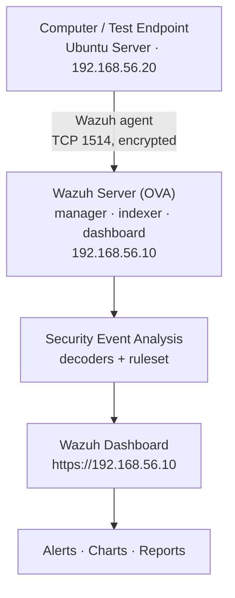

# SIEM Log Monitoring Lab — Report

> Fill in the bracketed fields, attach screenshots, and delete the guidance text.
> Aim for 8–12 pages including evidence.

| | |
|---|---|
| **Name** | [your name] |
| **Student / ID** | [id] |
| **Module** | [module code and title] |
| **Submission date** | [date] |
| **Option selected** | Option 2 — Install Wazuh in VirtualBox |

---

## 1. Executive summary (150–200 words)

[Two or three sentences on what was built. Then the headline results: how many agents, how many
alerts, which attack classes were detected, and the single most interesting alert you
investigated. Finish with the conclusion — did the system meet the objective?]

**Headline results**

| Metric | Value |
|---|---|
| Agents enrolled | [1] |
| Alerts generated during testing | [n] |
| Critical alerts (level ≥ 12) | [n] |
| ATT&CK techniques observed | [T1110, T1548.003, …] |
| Mean time from action to alert | [n seconds] |

---

## 2. Objective and scope

**Objective.** Collect and analyse security logs in one place; monitor a computer for security
events and surface alerts in the Wazuh dashboard.

**In scope**

- Deploy a Wazuh server as a virtual machine (Option 2).
- Enrol a separate test endpoint as a monitored agent.
- Detect: repeated failed logins, suspicious SSH activity, monitored-file changes, privilege
  escalation, and any other events the ruleset identifies.
- Present alerts, charts, and a report in the Wazuh dashboard.

**Out of scope**

- Production hardening, high availability, multi-node clustering.
- Real internet-facing exposure (the lab runs on a host-only network).

---

## 3. Architecture

[Insert a copy of the Mermaid diagram below rendered as an image, or your own.]



**Component responsibilities**

| Component | Role in this lab |
|---|---|
| Test endpoint (`192.168.56.20`) | Produces the logs: `sshd`, `sudo`, `pam`, file changes |
| Wazuh agent | Tails local logs, watches files (FIM), forwards events |
| Wazuh manager | Decodes and correlates events; runs the ruleset; stores alerts |
| Wazuh indexer | Stores and indexes alerts for search |
| Wazuh dashboard | Visualisation, triage, charts, reporting |

**Network design.** Both VMs use two adapters: `NAT` for internet access during installation and
a `Host-only` adapter (`vboxnet0`, `192.168.56.0/24`, DHCP off) for lab traffic. The dashboard is
reachable only from the host at `https://192.168.56.10`.

---

## 4. Implementation

### 4.1 Environment

| Item | Value |
|---|---|
| Hypervisor | VirtualBox [version] |
| Host OS | [Windows 11 / macOS / Ubuntu] |
| Host resources | [n] vCPU, [n] GB RAM |
| Wazuh version | [4.x.y from the OVA] |
| Endpoint OS | Ubuntu Server 24.04 LTS |
| Manager IP | 192.168.56.10 |
| Endpoint IP | 192.168.56.20 |

### 4.2 Wazuh server deployment

1. Imported the OVA; set graphics controller to **VMSVGA** (prevents the VM window freezing).
2. Adapter 1 = NAT, Adapter 2 = Host-only (vboxnet0); static IP `192.168.56.10/24` via `nmtui`.
3. Confirmed `wazuh-manager`, `wazuh-indexer`, `wazuh-dashboard` are active.
4. Logged into `https://192.168.56.10` as `admin` and changed the default password.

[Insert screenshot: `systemctl status` of the three services]

### 4.3 Agent deployment

1. Installed Ubuntu Server with OpenSSH, static IP `192.168.56.20`.
2. Added the Wazuh APT repository and GPG key.
3. Installed with `WAZUH_MANAGER="192.168.56.10" WAZUH_AGENT_NAME="test-endpoint" apt install wazuh-agent`.
4. Held the package version (`apt-mark hold wazuh-agent`).
5. Verified enrollment: `agent_control -l` → `Active`.

[Insert screenshot: Agents management showing 1 active agent]

### 4.4 Detection configuration

**File integrity monitoring** — added to the agent's `ossec.conf`:

```xml
<syscheck>
  <frequency>300</frequency>
  <directories check_all="yes" report_changes="yes" realtime="yes">/opt/lab-watch</directories>
  <directories check_all="yes" report_changes="yes" realtime="yes" whodata="yes">/etc</directories>
  <directories check_all="yes" report_changes="yes" realtime="yes">/root</directories>
  <ignore type="sregex">.log$|.tmp$|.swp$</ignore>
</syscheck>
```

**Custom rules** — `local_rules.xml` (IDs 100100–100131):

| Rule | Level | Detects |
|---|---|---|
| 100100 | 10 | SSH brute force: 6+ invalid users in 120 s |
| 100101 | 12 | Successful SSH login after a brute-force burst |
| 100102 | 9 | Direct root SSH login |
| 100110 | 10 | Interactive root shell via `sudo` |
| 100111 | 9 | Repeated failed `sudo` attempts |
| 100112 | 10 | `/etc/sudoers` or `/etc/group` modified |
| 100120 | 10 | Sensitive system file modified |
| 100121 | 10 | Persistence artefact created |
| 100122 | 9 | System file deleted |
| 100130 | 8 | Account database modified |
| 100131 | 7 | SSH daemon configuration changed |

Rules were validated with `wazuh-analysisd -t` and tested with `wazuh-logtest` before use.

[Insert screenshot: wazuh-logtest showing rule 5710 then 5712]

---

## 5. Testing and results

Method: each scenario was executed from a script (`simulate-detections.sh`) and the resulting
alerts were captured with `verify-alerts.sh` plus dashboard screenshots.

### 5.1 Results table

| # | Test | Technique | Expected rule | Observed | Level | Pass |
|---|---|---|---|---|---|---|
| 1 | 12 failed SSH logins (invalid users) | T1110 | 5710 → 5712 | [n] alerts | 5 → 10 | ✅ |
| 2 | Success after failures | T1078 | 5715 → 100101 | [n] alerts | 3 → 12 | ✅ |
| 3 | File modified in `/opt/lab-watch` | T1565 | 550 | [n] | 7 | ✅ |
| 4 | File created / deleted | — | 554 / 553 | [n] | 5 / 7 | ✅ |
| 5 | `/etc/systemd/system/*.service` created | T1053 | 554 → 100121 | [n] | 10 | ✅ |
| 6 | `sudo bash` interactive shell | T1548.003 | 5402 → 100110 | [n] | 3 → 10 | ✅ |
| 7 | Repeated failed sudo | T1548.003 | 100111 | [n] | 9 | ✅ |
| 8 | Local account created | T1136 | 550 → 100130 | [n] | 8 | ✅ |

Fill `[n]` from the output of `verify-alerts.sh`.

### 5.2 Evidence

[Insert the following screenshots, each with a caption:]
1. Brute-force alert expanded, showing `data.srcip`, `data.dstuser`, `full_log`.
2. FIM alert showing the **diff** (`report_changes`) and before/after hashes.
3. Privilege-escalation alert (5402 → 100110).
4. The custom **SIEM Lab — Detection Overview** dashboard.
5. ATT&CK module filtered to T1110 and T1548.003.

### 5.3 Alert volume over the test period

[Insert the time-series chart. Note the spike that corresponds to each scenario and state the
approximate detection latency — measured from the script timestamp to the alert timestamp.]

Observed latency: [n] seconds (realtime FIM is typically < 5 s; SSH alerts are near-instant).

---

## 6. Analysis

### 6.1 What worked well

[Discuss: built-in rules 5710/5712 already cover brute force, so the value of custom rules is
correlation and severity tuning — turning a flood of level-5 events into one actionable level-10
alert; realtime FIM gives near-instant detection of `/etc` changes; MITRE mapping makes coverage
visible.]

### 6.2 Detection gaps and limitations

- [e.g. password-spray attacks that distribute one attempt per account across many IPs will not
  trip the same-source-IP correlation.]
- [FIM sees the change but not intent — `whodata` (auditd) is needed to attribute a user/process.]
- [The default 12-hour scan interval means non-realtime directories can miss short-lived files;
  we reduced it to 300 s.]
- [An agent that is stopped produces no logs — a silent failure. Wazuh's manager-side
  "agent disconnected" family (rule 506 / 503) is the right place to cover this, not FIM.]

### 6.3 Improvements for a production deployment

| Area | Recommendation |
|---|---|
| TLS | Replace the OVA's self-signed certificate; enforce TLS 1.2+ |
| Identity | No shared logins; integrate dashboard auth with LDAP/SSO; rotate API passwords |
| Scale | Separate manager, indexer, and dashboard onto distinct nodes; add a second indexer for HA |
| Retention | Configure index lifecycle management and a cold-storage tier |
| Noise | Tune out `systemd` unit churn and package-manager churn with targeted `<ignore>` entries |
| Response | Enable active response carefully; add alerting into email/Slack for level ≥ 12 |
| Coverage | Add Sysmon on Windows endpoints; add cloud audit-log ingestion; map rules to CIS controls |

---

## 7. Conclusion

[Did the deployment meet the objective? Restate the four required detection classes and that
each was demonstrated with evidence. Note what you would do differently next time.]

---

## 8. References

1. Wazuh documentation — Virtual machine deployment. <https://documentation.wazuh.com/current/deployment-options/virtual-machine/virtual-machine.html>
2. Wazuh documentation — File integrity monitoring. <https://documentation.wazuh.com/current/user-manual/capabilities/file-integrity/>
3. Wazuh documentation — Ruleset syntax and `wazuh-logtest`. <https://documentation.wazuh.com/current/user-manual/reference/tools/wazuh-logtest.html>
4. Wazuh documentation — Detecting a brute-force attack. <https://documentation.wazuh.com/current/proof-of-concept-guide/detect-brute-force-attack.html>
5. Wazuh documentation — Blocking SSH brute force with active response. <https://documentation.wazuh.com/current/user-manual/capabilities/active-response/ar-use-cases/blocking-ssh-brute-force.html>
6. MITRE ATT&CK — T1110 Brute Force. <https://attack.mitre.org/techniques/T1110/>
7. MITRE ATT&CK — T1548.003 Sudo and Sudo Caching. <https://attack.mitre.org/techniques/T1548/003/>

---

## Appendix A — Configuration excerpts

[Paste your final `ossec.conf` syscheck block, `local_rules.xml`, and the active-response block.]

## Appendix B — Command log

```bash
# manager
sudo /var/ossec/bin/agent_control -l
sudo systemctl status wazuh-manager wazuh-indexer wazuh-dashboard

# endpoint
sudo systemctl status wazuh-agent
sudo ./simulate-detections.sh all

# verification
sudo ./verify-alerts.sh
```

## Appendix C — Screenshot index

| Figure | Caption |
|---|---|
| 1 | Lab topology / VirtualBox network settings |
| 2 | Service health on the manager |
| 3 | Agent enrolled and active |
| 4 | Brute-force alert detail |
| 5 | FIM alert with diff |
| 6 | Privilege-escalation alert |
| 7 | Custom detection dashboard |
| 8 | ATT&CK coverage view |
